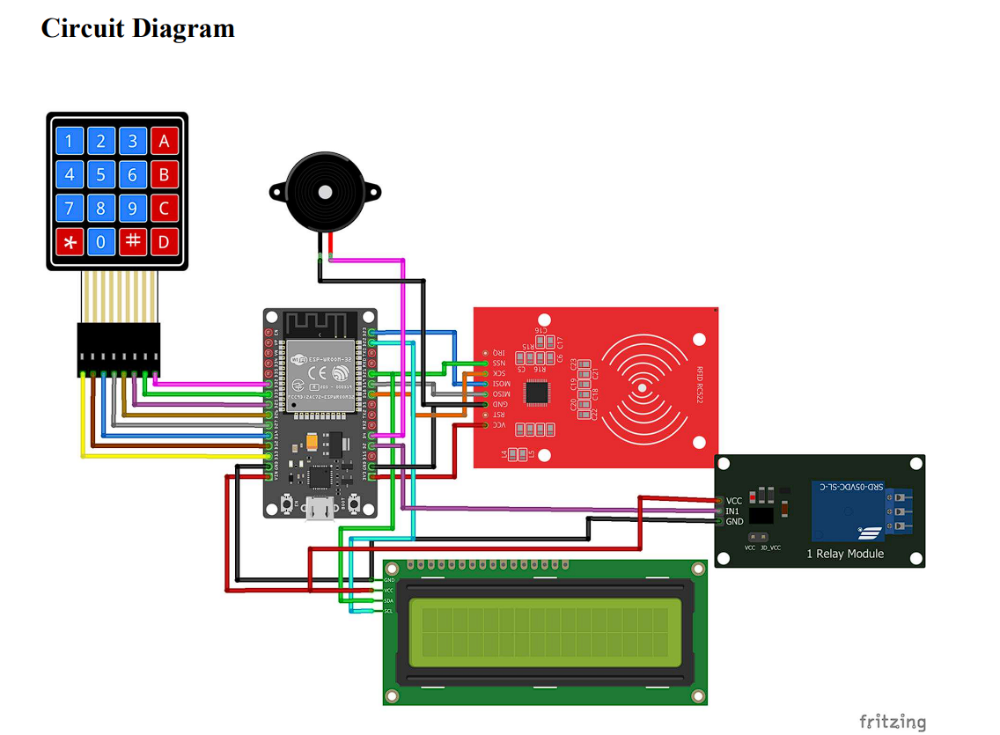

# 🔐 RFID-Based Smart Lock System with IoT Integration

<p align="center">
  <strong>An RFID-based access control system using NodeMCU, a 12V solenoid lock, and Google Sheets integration.</strong>
</p>

<p align="center">
  
  
  
  
</p>

<p align="center">
  <a href="#-overview">Overview</a> •
  <a href="#-features">Features</a> •
  <a href="#-hardware-requirements">Hardware</a> •
  <a href="#-system-architecture">Architecture</a> •
  <a href="#-installation-and-setup">Setup</a> •
  <a href="#-testing-and-validation">Testing</a>
</p>

---

## 📌 Overview

The **RFID-Based Smart Lock System** is an embedded access control project that combines RFID technology, a Wi-Fi-enabled microcontroller, an electronic locking mechanism, and Google Sheets integration.

The system reads an RFID card or tag, checks its authorization, and controls a 12V solenoid lock according to the authentication result. Google Sheets integration supports the management of registered card information and the recording of access events, including timestamps and cardholder details where configured.

The project demonstrates the practical application of embedded systems, wireless communication, RFID authentication, and cloud-connected data management.

## ✨ Features

- 🪪 **RFID Authentication** — Identify RFID cards and tags presented to the reader.
- 👤 **Card Registration** — Register card identifiers for access control.
- 🔓 **Electronic Lock Control** — Operate a 12V solenoid lock through a suitable driver circuit.
- ⏱️ **Timed Unlocking** — Activate the solenoid lock for a configured duration of two seconds after successful card recognition.
- ☁️ **Google Sheets Integration** — Integrate cloud-based spreadsheet data into the authentication and logging workflow.
- 📊 **Access Event Logging** — Record access information and timestamps when the logging integration is operational.
- 📋 **Organized Data Management** — Separate registered-card information from access-event records.

> Feature availability depends on the selected firmware and configuration. Refer to the relevant source files for implementation details.

## 🛠️ Hardware Requirements

| Component | Purpose |
|---|---|
| NodeMCU 0.9 / ESP8266 | Main controller and Wi-Fi connectivity |
| RFID reader module | Reads RFID card or tag identifiers |
| RFID cards or tags | User identification |
| 12V solenoid lock | Electronic locking mechanism |
| Relay module or suitable driver | Controls the solenoid lock |
| Buzzer (if used) | Audio feedback |
| Appropriate power supplies | Powers the controller and locking mechanism |
| Jumper wires and connecting hardware | Electrical connections |

**Note:** Confirm the exact RFID reader model, voltage requirements, and current ratings before assembling the circuit.

## 💻 Software Requirements

- Arduino IDE or the development environment used by the project.
- ESP8266 board support package.
- RFID library compatible with the selected reader.
- Required Wi-Fi and communication libraries.
- Google Sheets and a configured integration endpoint, if required by the firmware.

The exact library names and configuration settings should be taken from the source code in this repository.

## 🧠 System Architecture

The block diagram below illustrates the overall design of the RFID-Based Smart Lock System.

<p align="center">
  
</p>

<p align="center">
  <em>System architecture showing the main components and their interactions.</em>
</p>

> Replace the image path above with the actual location of your block diagram. GitHub supports displaying repository images directly in Markdown.

## ⚙️ Working Principle

1. **Initialization:** The NodeMCU initializes the RFID reader and the required peripherals.
2. **Card Detection:** A user presents an RFID card or tag to the reader.
3. **Authentication:** The firmware evaluates the card identifier against the configured authorization data.
4. **Access Decision:** Authorized cards trigger the lock-control sequence, while unauthorized cards are denied access.
5. **Lock Operation:** The controller activates the lock driver to operate the solenoid lock for the configured duration.
6. **Data Logging:** When the Google Sheets integration is available, relevant access information is transmitted for recording.
7. **Access Management:** Registered-card data and access records can be maintained through the configured data-management workflow.

The exact authentication flow depends on whether the selected firmware checks locally stored card identifiers or retrieves authorization data through the network.

## 🔌 Circuit Connections

Refer to the project's block diagram, circuit schematic, and source code for the verified hardware connections.

The RFID reader typically communicates with the NodeMCU through an SPI interface. The exact pin mapping depends on the selected reader and controller configuration.

| Connection | Description |
|---|---|
| RFID reader to NodeMCU | SPI communication and required control signals |
| NodeMCU to lock driver | Control signal for the relay or switching circuit |
| Lock driver to solenoid | Switched power connection for the 12V lock |
| Buzzer to controller | Configured output connection, if applicable |
| Power and ground | Connections according to the verified circuit design |

⚠️ **Electrical Safety**

- Never connect a 12V solenoid lock directly to a NodeMCU GPIO pin.
- Use an appropriately rated relay or driver circuit.
- Provide a suitable power supply for the solenoid lock.
- Use appropriate protection against inductive voltage spikes.
- Verify voltage compatibility and wiring before applying power.

## 🚀 Installation and Setup

### 1. Clone the Repository

```bash
git clone https://github.com/Paul-Rohit/RFID-based-Lock-System.git
cd RFID-based-Lock-System
```

### 2. Explore the Repository

The project contains the following directories:

| Directory | Purpose |
|---|---|
| `RFID_locksys/` | RFID lock system implementation |
| `RFID_locksys_card_name_writer/` | Card-name writing or registration-related implementation |
| `RFID_attendance/` | Attendance-related implementation |

Review each directory to identify the appropriate firmware and its dependencies.

### 3. Configure the Development Environment

1. Install the Arduino IDE or the required development environment.
2. Install the ESP8266 board support package.
3. Install the libraries required by the selected firmware.
4. Open the appropriate source file.
5. Select the correct NodeMCU board and serial port.

### 4. Configure Google Sheets Integration

If the selected firmware uses Google Sheets:

1. Prepare the spreadsheet structure expected by the firmware.
2. Configure the required Google Apps Script or other integration endpoint, if applicable.
3. Configure the endpoint and any required settings in the firmware.
4. Set up Wi-Fi connectivity.
5. Verify authentication and access-event logging.

**Security:** Do not commit Wi-Fi passwords, private tokens, or other sensitive credentials to the repository. Store private configuration values outside committed source files.

### 5. Connect the Hardware and Upload

1. Assemble the circuit using the verified schematic.
2. Check all power and signal connections.
3. Connect the NodeMCU to your computer.
4. Upload the firmware.
5. Open the serial monitor if diagnostic output is supported.
6. Test the system with registered and unregistered RFID cards.

## 🧪 Testing and Validation

Use the following test cases to evaluate the system.

| Test Case | Expected Behavior |
|---|---|
| Registered RFID card | Access is granted according to the configured authentication logic |
| Unregistered RFID card | Access is denied |
| Solenoid lock activation | Lock operates for the configured duration |
| Google Sheets connectivity | Data is transmitted when the integration is operational |
| Timestamp recording | Access records contain the expected date and time |
| Network unavailable | System follows its implemented network-failure behavior |
| RFID reader initialization failure | Failure can be identified through available diagnostics or testing |

Record actual test results after validating the hardware and firmware. Network recovery and offline access should not be assumed unless they are implemented and tested.

## 📁 Repository Structure

```text
RFID-based-Lock-System/
├── RFID_attendance/
├── RFID_locksys/
├── RFID_locksys_card_name_writer/
├── docs/
│   └── images/
│       └── rfid-block-diagram.png
├── .gitignore
├── LICENSE
└── README.md
```

The `docs/images/` directory is a suggested location for your block diagram, circuit schematic, and hardware photographs. Create it and add the diagram if it does not already exist.

## 🔐 Security Considerations

This project is intended primarily for educational and prototyping purposes.

- **RFID security:** Card identifiers alone may be cloned or emulated. Stronger authentication may be required for security-sensitive applications.
- **Cloud security:** Protect Google Sheets integration endpoints and restrict access to authentication data.
- **Credential management:** Keep passwords, private tokens, and sensitive deployment information out of committed files.
- **Network failures:** Define and test how authentication and logging behave when the network is unavailable.
- **Physical security:** Use a suitable lock driver and power supply, and evaluate emergency access and the required fail-safe or fail-secure behavior.

A production installation requires additional security analysis and testing.

## 🔮 Future Improvements

Potential improvements include:

- Stronger RFID authentication.
- Card enrollment and revocation management.
- Improved network error handling.
- Offline access logging and later synchronization.
- LCD or LED status indicators and audible feedback.
- Enhanced diagnostics and automated testing.
- More comprehensive circuit and deployment documentation.

These are possible future enhancements, not claims that the features are already implemented.

## 📸 Development References

The following posts provide supplementary context about selected development stages. The source code and circuit documentation in this repository remain the primary technical references.

| Development Stage | Reference |
|---|---|
| Hardware planning and circuit design | [View post](https://lnkd.in/p/d98faMzJ) |
| Hardware-software integration and card registration | [View post](https://lnkd.in/p/d2cMjFqb) |
| Code refinement and testing | [View post](https://lnkd.in/p/dWDNeKNT) |
| Google Sheets integration and access logging | [View post](https://lnkd.in/p/dsJS8HSS) |
| Authentication data and access-record management | [View post](https://lnkd.in/p/d3A8Q998) |

## 🤝 Contributions

Suggestions, bug reports, and improvements are welcome.

If you identify an issue or have an idea for improving the project, open a GitHub issue with a clear description and relevant technical details.

## 📄 License

This project is intended to be distributed under the MIT License if the repository's `LICENSE` file confirms those terms.

See the [`LICENSE`](LICENSE) file for the applicable conditions.

---

<p align="center">
  <strong>Built to explore RFID authentication, embedded systems, electronic access control, and IoT integration.</strong>
</p>
